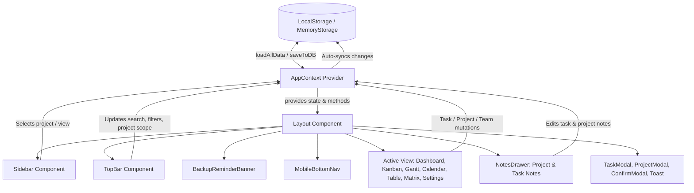
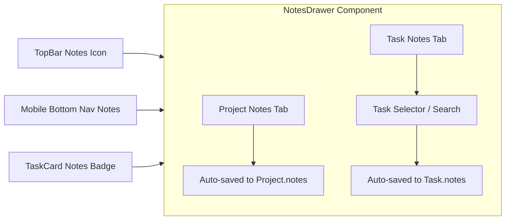

# Comprehensive Project Context: ProjectFlow (Test_Project)

> **Document Version:** 3.0.0  
> **Target Audience:** Developers, System Architects, AI Coding Assistants  
> **Repository:** `Test_Project` (Application Title: **ProjectFlow**)  
> **Build Target:** Standalone Portable Single-File Web Application (`ProjectFlow.html`)  
> **Last Verified:** Current Workspace

---

## 📑 Table of Contents
1. [Executive Summary & Core Value Proposition](#-executive-summary--core-value-proposition)
2. [Technology Stack & Dependency Blueprint](#-technology-stack--dependency-blueprint)
3. [Complete Directory & File Architecture](#-complete-directory--file-architecture)
4. [Global State Architecture (`AppContext.jsx`)](#-global-state-architecture-appcontextjsx)
5. [Data Models & Schema Reference](#-data-models--schema-reference)
6. [Persistence Layer & File-Safe Storage (`useDatabase.js`)](#-persistence-layer--file-safe-storage-usedatabasejs)
7. [Component Hierarchy & Prop Contracts](#-component-hierarchy--prop-contracts)
8. [Comprehensive Views & Feature Specifications](#-comprehensive-views--feature-specifications)
9. [Notes System: Project Notes & Task Notes (`NotesDrawer.jsx`)](#-notes-system-project-notes--task-notes-notesdrawerjsx)
10. [Data Protection & Backup Reminder System](#-data-protection--backup-reminder-system)
11. [Cloud Sync Pitch & Upsell Architecture (`CloudSyncPitch.jsx`)](#-cloud-sync-pitch--upsell-architecture-cloudsyncpitchjsx)
12. [Internationalization & Multi-Language Engine (`i18n.js`)](#-internationalization--multi-language-engine-i18njs)
13. [Styling, Theme Engine & Design System (`index.css`)](#-styling-theme-engine--design-system-indexcss)
14. [Utility Functions & Business Logic (`helpers.js` & `constants.js`)](#-utility-functions--business-logic-helpersjs--constantsjs)
15. [Build, Deployment & Development Toolchain](#-build-deployment--development-toolchain)

---

## 📌 Executive Summary & Core Value Proposition

**ProjectFlow** is a client-side Project and Task Management Dashboard web application designed with modern aesthetics, zero external backend dependency, and full offline persistence.

### Key Capabilities:
- **7 Comprehensive Visual Perspectives:**
  1. *Dashboard* (KPI metrics, circular progress pills, donut breakdown, priority histogram, workload distribution, progress bars)
  2. *Kanban Board* (HTML5 drag-and-drop column workflows with quick add per status)
  3. *Gantt Chart* (interactive horizontal timeline scheduling with date-range bounds)
  4. *Calendar View* (monthly grid, multi-day span bars, day popover)
  5. *Table View* (tabular data list with multi-column ascending/descending sorting)
  6. *Eisenhower Matrix* (2x2 Urgency vs. Importance priority matrix with drag-and-drop priority assignment)
  7. *Settings* (i18n localization, team member management, backup interval config, JSON import/export, and Cloud Sync upgrade portal)
- **Local-First Architecture:** Resilient storage layer (`useDatabase.js`) utilizing `window.localStorage` with an in-memory fallback, specifically crafted for 100% functionality under `file:///` URLs without security origin sandbox errors.
- **Single-File Bundling Capability:** Powered by `vite-plugin-singlefile` enabling standalone, fully portable offline distribution as a single `ProjectFlow.html` file that opens in any browser without a web server.
- **Integrated Dual-Scope Notes System:** Slide-out rich notepad supporting both Project-level notes and Task-level notes with quick insertions (timestamps, checklists, bullets) and auto-save.
- **Data Safety & Backup Reminders:** Configurable reminder cadence (1, 3, 7, 14, 30 days) with top banner alerts, quick export, and snooze capabilities.
- **Built-in Multilingual Support:** Translation dictionary for English (`en`), French (`fr`), German (`de`), Spanish (`es`), and Japanese (`ja`).

---

## 🛠️ Technology Stack & Dependency Blueprint

| Category | Technology | Version | Purpose |
| :--- | :--- | :--- | :--- |
| **Framework** | React | `^19.2.6` | Modern React with hooks, functional components, and context |
| **DOM Renderer** | React DOM | `^19.2.6` | DOM bindings and portal rendering |
| **Bundler & Tooling** | Vite | `^8.0.12` | Next-generation ESM dev server and build tool |
| **Vite Plugins** | `@vitejs/plugin-react` | `^6.0.1` | React Fast Refresh and JSX transformation |
| **Single-File Plugin** | `vite-plugin-singlefile` | `^2.3.3` | Inlines all JS, CSS, and fonts into a standalone HTML file |
| **Styling & Theme** | Tailwind CSS | `^4.3.1` | Modern utility-first CSS framework with `@theme` engine |
| **Tailwind Vite Integration** | `@tailwindcss/vite` | `^4.3.1` | Native Vite integration for Tailwind v4 |
| **Icons** | Lucide React | `^1.18.0` | Modern SVG icon library |
| **Date Utilities** | `date-fns` | `^4.4.0` | Parsing, formatting, intervals, and relative date calculation |
| **Client Storage** | LocalStorage + Memory Fallback | Native | Zero-dependency synchronous client storage compatible with `file://` |
| **Linter** | ESLint | `^10.3.0` | Static analysis with React Hooks & React Refresh rules |

---

## 📁 Complete Directory & File Architecture

```
Test_Project/
├── public/                         # Static public assets
│   ├── favicon.svg
│   └── icons.svg
├── src/
│   ├── assets/                     # SVGs and bundled media
│   │   ├── hero.png
│   │   ├── react.svg
│   │   └── vite.svg
│   ├── components/                 # Reusable UI layout & module components
│   │   ├── BackupReminderBanner.jsx# Dismissible banner alerting when workspace backup is due
│   │   ├── CloudSyncPitch.jsx      # Executive comparison view & promo card for Online Cloud edition
│   │   ├── ConfirmModal.jsx        # React Portal confirmation dialog (danger/warning variants)
│   │   ├── Layout.jsx              # Main shell (Sidebar + TopBar + Active View + Drawers/Modals)
│   │   ├── MobileBottomNav.jsx     # Mobile fixed bottom tab bar for fast one-handed navigation
│   │   ├── NotesDrawer.jsx         # Slide-out drawer for Project Notes and Task Notes
│   │   ├── PillMetricCard.jsx      # Glassmorphic KPI pill card with animated SVG circle meter
│   │   ├── ProjectModal.jsx        # Modal for creating and editing projects (color picker, notes)
│   │   ├── ProjectScopeBar.jsx     # Horizontal scrollable project filter pills across views
│   │   ├── Sidebar.jsx             # Collapsible desktop/mobile drawer with project CRUD & views
│   │   ├── TaskCard.jsx            # Draggable task card with tags, avatars, badges, due dates, notes
│   │   ├── TaskModal.jsx           # Modal for task creation, editing, notes, and deletion
│   │   ├── Toast.jsx               # Self-dismissing toast notifications (success, error, info, magic)
│   │   └── TopBar.jsx              # View title, scope picker, search, filters, backup pill, new task
│   ├── context/
│   │   └── AppContext.jsx          # Central React Context Provider (`AppProvider`, `useApp`)
│   ├── hooks/
│   │   ├── useDatabase.js          # File-safe LocalStorage loader, auto-sync, JSON backup import/export
│   │   ├── useLocalStorage.js      # Generic persistent local storage hook
│   │   └── useTheme.js             # Light/Dark mode state synced with DOM and localStorage
│   ├── utils/
│   │   ├── constants.js            # Statuses, Priorities, Avatar colors, Tag themes, Seed data
│   │   ├── helpers.js              # ID generator, initials, relative dates, sorting, progress %, backups
│   │   └── i18n.js                 # Dictionary strings for EN, FR, DE, ES, JA
│   ├── views/                      # Primary screen components
│   │   ├── CalendarView.jsx        # Monthly calendar with multi-day bars & day popovers
│   │   ├── DashboardView.jsx       # Metrics, charts, team workload, project progress bars
│   │   ├── EisenhowerMatrixView.jsx# 2x2 Urgency/Importance drag-drop priority matrix
│   │   ├── GanttView.jsx           # Interactive horizontal timeline chart
│   │   ├── KanbanView.jsx          # 4-column drag-and-drop workflow board
│   │   ├── SettingsView.jsx        # Preferences, Team Roster, Data Management, Cloud Sync Pitch
│   │   └── TableView.jsx           # Data grid with multi-column sorting and filtering
│   ├── App.jsx                     # Application root wrapped in `AppProvider`
│   ├── index.css                   # Design system tokens, Tailwind v4 imports, keyframes, scrollbars
│   └── main.jsx                    # DOM mount entry point
├── eslint.config.js                # Flat ESLint configuration
├── index.html                      # HTML5 document template
├── package.json                    # Project dependencies and npm scripts
├── ProjectFlow.html                # Standalone bundled distribution file
├── PROJECT_CONTEXT.md              # Comprehensive technical and contextual specification
├── README.md                       # Quick start instructions
└── vite.config.js                  # Vite build configuration (singlefile + tailwind)
```

---

## ⚡ Global State Architecture (`AppContext.jsx`)

The entire application state is unified within `AppContext.jsx` and consumed across components via the custom hook `useApp()`.

### State Flow Diagram



### Complete State Properties Provided by `useApp()`:

| Property | Type | Description |
| :--- | :--- | :--- |
| `projects` | `Array<Project>` | List of all active projects |
| `tasks` | `Array<Task>` | Master list of all tasks |
| `team` | `Array<TeamMember>` | List of team members available for task assignment |
| `filteredTasks` | `Array<Task>` | Computed tasks filtered by `activeProjectId` and TopBar `filters` |
| `activeProjectId` | `string` | Currently focused project (`'all'` or project ID) |
| `activeView` | `string` | Current view: `'dashboard' \| 'kanban' \| 'gantt' \| 'calendar' \| 'table' \| 'matrix' \| 'settings'` |
| `lastProjectView` | `string` | Previous view remembered before entering settings |
| `sidebarCollapsed` | `boolean` | Desktop collapsed state (icon rail vs. full sidebar) |
| `mobileMenuOpen` | `boolean` | Mobile drawer visibility toggle |
| `filters` | `Object` | Filter controls: `{ project, status, priority, member, search }` |
| `language` | `string` | Active locale code (`'en'`, `'fr'`, `'de'`, `'es'`, `'ja'`) |
| `isDark` | `boolean` | Dark mode flag synced to `html.dark` |
| `isInitialized` | `boolean` | True once initial data is loaded from storage |
| `lastBackupDate` | `string \| null` | ISO timestamp of the last JSON backup created |
| `backupReminderDays`| `number` | Frequency interval in days (e.g. 7; 0 means off) |
| `isBackupDue` | `boolean` | Computed boolean indicating if a backup is due/overdue |
| `daysSinceLastBackup`| `number \| null` | Integer count of days elapsed since the last backup |
| `backupSnoozed` | `boolean` | True if the current session has dismissed the backup banner |
| `settingsTab` | `string` | Active tab in Settings (`'preferences' \| 'team' \| 'data' \| 'cloud'`) |
| `projectModalState` | `Object` | `{ isOpen: boolean, project: Project \| null }` |
| `notesDrawer` | `Object` | `{ isOpen: boolean, tab: 'project' \| 'task', selectedTaskId, selectedProjectId }` |

### Context Methods & Mutations:

```javascript
// Theme
toggleTheme()                          // Toggles dark / light theme

// Filter Control
setFilters(updaterFnOrObj)             // Updates filter state
clearFilters()                         // Resets all filters to 'all' and search to ''

// Navigation & UI
setActiveProjectId(id)                 // Switches project scope (switches back to lastProjectView if in settings)
setActiveView(viewId)                  // Switches active screen view
setSidebarCollapsed(bool)              // Collapses or expands desktop sidebar
setMobileMenuOpen(bool)                // Opens or closes mobile navigation drawer
showToast(title, message, type)        // Triggers self-dismissing toast (success, error, info, magic)

// Project Modal Control
openNewProjectModal()                  // Opens project creation modal
openEditProjectModal(project)          // Opens project edit modal with selected project
closeProjectModal()                    // Closes project modal

// Notes Drawer Control
openNotes({ tab, taskId, projectId })  // Opens notes drawer focusing on task or project
closeNotes()                           // Closes notes drawer

// Backup Management
triggerBackup()                        // Exports JSON file, timestamps backup, triggers success toast
snoozeBackupReminder()                 // Temporarily suppresses backup banner
openBackupSettings()                   // Direct navigation to Settings -> Data tab
openCloudPitch()                       // Direct navigation to Settings -> Cloud Sync tab

// Internationalization
setLanguage(langCode)                  // Switches app locale
t(translationKey, params)              // Translates string with parameter replacement support

// Project CRUD
addProject(projectInput)               // Creates project with custom color or automatic palette cycling
updateProject(id, updates, quiet)      // Updates project properties (e.g. name, color, notes)
deleteProject(id)                      // Deletes project and cascades deletion to child tasks

// Task CRUD
addTask(taskData)                      // Generates task ID, defaults dates, assigns to current project
updateTask(id, updates, quiet)         // Mutates task fields (supports quiet flag for auto-saving notes)
deleteTask(id)                         // Removes task
moveTask(taskId, newStatus)            // Updates status field for drag-and-drop columns

// Team CRUD
addTeamMember(name, role)              // Adds member with random avatar color from AVATAR_COLORS
deleteTeamMember(id)                   // Removes member and unassigns member from existing tasks

// Data Administration
clearAllData()                         // Purges all projects, tasks, team, and filters
resetData()                            // Restores workspace to initial default seed datasets
```

---

## 📦 Data Models & Schema Reference

### 1. Project Schema
```typescript
interface Project {
  id: string;          // e.g., "proj-1", "proj-17192348234-x8f2"
  name: string;        // Project display title
  color: string;       // HEX color (e.g., "#ef4444")
  description?: string;// Project summary description
  notes?: string;      // Persistent project notepad (markdown / plaintext)
  createdAt: string;   // ISO 8601 timestamp
}
```

### 2. Task Schema
```typescript
interface Task {
  id: string;          // e.g., "task-1", "task-17192348234-y7d1"
  title: string;       // Task headline title
  description: string; // Detailed task requirements
  projectId: string;   // Associated Project ID
  status: 'todo' | 'in-progress' | 'review' | 'done';
  priority: 'low' | 'medium' | 'high' | 'urgent';
  assigneeId: string;  // TeamMember ID or empty string
  startDate: string;   // "YYYY-MM-DD"
  endDate: string;     // "YYYY-MM-DD"
  tags: string[];      // Array of tag keys (e.g., ["design", "frontend"])
  notes?: string;      // Dedicated per-task notes / checklists
  createdAt: string;   // ISO 8601 timestamp
}
```

### 3. Team Member Schema
```typescript
interface TeamMember {
  id: string;          // e.g., "tm-1", "tm-17192348234-z3k9"
  name: string;        // Full name (e.g., "Alice Chen")
  role: string;        // Role title (e.g., "Project Lead", "Developer")
  avatarColor: string; // HEX color assigned from AVATAR_COLORS
}
```

### 4. Filter State Schema
```typescript
interface FilterState {
  project: string;     // 'all' | Project ID
  status: string;      // 'all' | 'todo' | 'in-progress' | 'review' | 'done'
  priority: string;    // 'all' | 'low' | 'medium' | 'high' | 'urgent'
  member: string;      // 'all' | TeamMember ID
  search: string;      // Free-form search query matched against title and description
}
```

---

## 💾 Persistence Layer & File-Safe Storage (`useDatabase.js`)

Unlike standard web applications that depend on remote servers or IndexedDB databases that fail under strict local file permissions, ProjectFlow uses a resilient **File-Safe Storage Engine**:

### Architecture Highlights:
- **Primary Mechanism:** `window.localStorage` with wrapped JSON serialization.
- **Fail-Safe Fallback:** In-memory `Map` storage if `localStorage` access is restricted (e.g., sandboxed `file:///` viewing in private browsing).
- **Asynchronous Signatures:** Maintained so future cloud synchronization modules can hook in without interface refactoring.

### Store Keys Mapping:
| Key Constant | Storage Key | Description |
| :--- | :--- | :--- |
| `STORE_KEYS.PROJECTS` | `projectflow-projects` | Array of projects |
| `STORE_KEYS.TASKS` | `projectflow-tasks` | Array of tasks |
| `STORE_KEYS.TEAM` | `projectflow-team` | Array of team members |
| `STORE_KEYS.ACTIVE_PROJECT` | `projectflow-active-project` | Current active project ID |
| `STORE_KEYS.ACTIVE_VIEW` | `projectflow-active-view` | Current view ID |
| `STORE_KEYS.SIDEBAR_COLLAPSED` | `projectflow-sidebar-collapsed` | Boolean desktop sidebar state |
| `STORE_KEYS.MOBILE_MENU` | `projectflow-mobile-menu` | Boolean mobile drawer state |
| `STORE_KEYS.FILTERS` | `projectflow-filters` | Filter object |
| `STORE_KEYS.LANGUAGE` | `projectflow-language` | Active locale code |
| `STORE_KEYS.LAST_BACKUP` | `projectflow-last-backup-date`| Timestamp of last exported backup |
| `STORE_KEYS.BACKUP_REMINDER_DAYS` | `projectflow-backup-reminder-days` | Cadence for backup reminder alerts |

### Backup & Restore APIs:
- `exportAppData()`: Compiles all stores into an indented JSON file named `ProjectFlow_Backup_YYYY-MM-DD_HH-mm-ss.json`, updates `LAST_BACKUP`, and triggers a download.
- `importAppData(jsonString)`: Validates and parses the backup JSON, restores all stores, and triggers a clean reload.

---

## 🧩 Component Hierarchy & Prop Contracts

```
<App>
  └── <AppProvider>
        ├── <Toast /> (Rendered via AppContext)
        └── <Layout>
              ├── <Sidebar />
              │     └── <ConfirmModal /> (Project delete confirmation)
              ├── <TopBar onNewTask={fn} />
              │     ├── [Project Scope Dropdown]
              │     └── [Backup Status Popover Modal via Portal]
              ├── <BackupReminderBanner /> (Shown when backup due)
              ├── <main>
              │     ├── <ProjectScopeBar /> (Used in Calendar, Matrix, Gantt, Kanban, Table)
              │     ├── <DashboardView />
              │     │     └── <PillMetricCard />
              │     ├── <KanbanView onEditTask={fn} onNewTask={fn} />
              │     │     └── <TaskCard />
              │     ├── <GanttView onEditTask={fn} />
              │     ├── <CalendarView onEditTask={fn} onNewTask={fn} />
              │     ├── <TableView onEditTask={fn} />
              │     ├── <EisenhowerMatrixView onEditTask={fn} onNewTask={fn} />
              │     │     └── <TaskCard />
              │     └── <SettingsView />
              │           ├── <CloudSyncBannerCard />
              │           ├── <CloudSyncPitchView />
              │           └── <ConfirmModal /> (Clear/Reset confirmation)
              ├── <MobileBottomNav /> (Mobile only)
              ├── <NotesDrawer onEditTask={fn} />
              ├── <TaskModal task={taskObj} onClose={fn} />
              └── <ProjectModal project={projObj} onClose={fn} />
```

### Component Details:

#### 1. `Layout.jsx`
- Orchestrates view swapping based on `activeView`.
- Manages state for `modalTask` (editing existing task or creating a new task with status/priority overrides) and modal visibility.
- Renders an animated pulse loading screen while `isInitialized` is `false`.
- Hosts `BackupReminderBanner`, `MobileBottomNav`, `NotesDrawer`, `TaskModal`, and `ProjectModal`.

#### 2. `TopBar.jsx`
- View title with mobile drawer trigger.
- **Project Scope Dropdown (sm+):** Displays active project name and color; dropdown reveals all projects, task counts per project, quick edit pencils, and `+ New Project` button.
- **Backup Status Indicator:** Pill showing "Backup: Just now" or "No Backup"; clicking opens a clean centered dialog with last backup date, elapsed time, reminder cadence, "Backup Now" action, and "Upgrade to Cloud Sync" banner.
- **Universal Search:** Instant title & description task search with clear button.
- **Filter Bar:** Multi-attribute filtering (Project, Status, Priority, Assignee).
- **Notes Drawer Trigger:** Desktop button with amber highlight when drawer is open.
- **Theme Toggle:** Instant Light/Dark toggle.
- **Primary CTA:** "+ New Task" button.

#### 3. `Sidebar.jsx`
- Desktop collapsed rail (60px) and expanded drawer (270px).
- Lists all primary views with dynamic icons.
- Projects list with completion progress bars, edit modals, and delete confirmations.
- Bottom footer with Settings link, "Report an Issue" link to Etsy (`https://grafitly.etsy.com`), and official Copyright (`© 2026 Grafitly`).

#### 4. `ProjectScopeBar.jsx`
- Horizontal scrollable pill track rendered at the top of Kanban, Gantt, Calendar, Table, and Matrix views.
- Allows switching project scope without opening the sidebar or top bar dropdown.
- Includes "All Projects" with total task counter, individual project pills with color dots, "+ New Project" button, and active scope clear badge.

#### 5. `NotesDrawer.jsx`
- Dual-tab slide-out panel (500px on desktop, full-width on mobile):
  - **Project Notes:** Dropdown to switch projects, live auto-saving textarea.
  - **Task Notes:** Combobox task picker with project filters and search, task metadata card (status, priority, due date, assignee, "Open Details" button), live auto-saving textarea.
- Quick editor formatting buttons: `+ Timestamp`, `+ Checklist`, `+ Bullet`, `Copy`, `Clear`.
- Word count and character count statistics.

#### 6. `BackupReminderBanner.jsx`
- Renders when `isBackupDue` is `true` and not snoozed.
- Informs the user how many days have elapsed since the last backup (or warns that data has never been backed up).
- Actions: "Backup Now" (triggers download), "Cloud Sync" (opens Cloud Pitch), and "Snooze" (dismisses banner for session).

#### 7. `CloudSyncPitch.jsx`
- Provides `CloudSyncBannerCard` (compact callout for Settings Data tab) and `CloudSyncPitchView` (enterprise comparison view).
- Details limitations of offline manual backups vs. benefits of continuous automated cloud backups, multi-device sync, and real-time collaboration.
- Includes "Copy Proposal Summary" clipboard action and direct links to contact the seller on Etsy.

#### 8. `TaskCard.jsx`
- Draggable card implementing HTML5 drag-and-drop.
- Features: project color indicator, task title, tags, overdue countdown with clock icon, priority badges, assignee avatar, and direct "Notes" button if notes exist.

#### 9. `TaskModal.jsx` & `ProjectModal.jsx`
- `TaskModal`: Form fields for Title, Description, Project, Status, Priority, Assignee, Start Date, End Date, Tags, and Task Notes.
- `ProjectModal`: Form fields for Project Name, 10-preset color palette or custom color picker, and Description.

---

## 🖥️ Comprehensive Views & Feature Specifications

### 1. Dashboard View (`DashboardView.jsx`)
- **KPI Metrics:** 5 glassmorphic `PillMetricCard` components (Projects, Open Tasks, Completion %, Overdue Tasks, Team Size).
- **Status Breakdown:** SVG Donut chart displaying proportion across To Do, In Progress, Review, and Done.
- **Priority Histogram:** Colored bar breakdown across Urgent, High, Medium, and Low.
- **Team Workload:** Ranked roster showing task counts and proportional load bars per team member.
- **Project Progress Grid:** Completion % meters and task count stats per project.
- **Velocity Trend:** Simulated 6-week completion velocity tracker.

### 2. Kanban Board View (`KanbanView.jsx`)
- 4 status columns: **To Do**, **In Progress**, **In Review**, **Done**.
- Native HTML5 Drag and Drop with column highlight on drag-over.
- Column header with task counter badge and quick `+ Add Task` button pre-configuring that column's status.
- Integrates `ProjectScopeBar` for instant project filtering.

### 3. Gantt Chart View (`GanttView.jsx`)
- Horizontal timeline scheduler with automatic date bounds calculation based on task dates with padding.
- Interactive horizontal scrolling with day headers, weekend highlighting, and "Today" marker line.
- Colored task duration bars with assignee avatar and day count; clicking any bar opens the task editor.
- Integrates `ProjectScopeBar`.

### 4. Calendar View (`CalendarView.jsx`)
- Monthly calendar grid powered by `date-fns`.
- Previous/Next month controls and "Today" quick jump.
- Multi-day task duration bars color-coded by priority.
- Interactive date cells with "+ More" popovers for days with multiple items.
- Integrates `ProjectScopeBar`.

### 5. Table View (`TableView.jsx`)
- Structured data grid view for bulk scanning.
- Interactive multi-column sorting (Title, Project, Status, Priority, Assignee, Start Date, End Date) with ascending/descending indicators.
- Responsive design: Converts to compact cards on mobile screens and full data table on desktop.
- Integrates `ProjectScopeBar`.

### 6. Eisenhower Matrix View (`EisenhowerMatrixView.jsx`)
- 2x2 priority matrix:
  - **Q1 (Urgent & Important):** *Do First* (`priority: 'urgent'`)
  - **Q2 (Not Urgent & Important):** *Schedule* (`priority: 'high'`)
  - **Q3 (Urgent & Not Important):** *Delegate* (`priority: 'medium'`)
  - **Q4 (Not Urgent & Not Important):** *Don't Do* (`priority: 'low'`)
- Drag-and-drop between quadrants to immediately update a task's priority.
- Integrates `ProjectScopeBar`.

### 7. Settings View (`SettingsView.jsx`)
- 4 segmented tabs:
  1. **Preferences:** Language switcher (EN, FR, DE, ES, JA) and official **Copyright & Product License Card** (`© 2026 Grafitly. All rights reserved.`, personal license terms, and link to Etsy store).
  2. **Team Members:** Team roster management (add member, assign roles, auto-assigned avatar colors, safe cascade deletion).
  3. **Data Management:** Backup status inspection, backup reminder interval selector (1, 3, 7, 14, 30 days or off), `CloudSyncBannerCard`, JSON workspace export, JSON workspace import with validation, Reset to Demo Data, and Clear All Data.
  4. **Cloud Sync:** Full `CloudSyncPitchView` comparing Offline vs. Online Cloud Sync editions with proposal copy and upgrade links.

---

## 📝 Notes System: Project Notes & Task Notes (`NotesDrawer.jsx`)

ProjectFlow provides a dual-scope persistent notes system:



- **Project Notes:** Scoped to the active project. Serves as a scratchpad for meeting agendas, project briefs, and brainstorms.
- **Task Notes:** Scoped to individual tasks. Serves for checklists, technical specifications, blocker details, and links.
- **Auto-Saving:** Every keystroke updates state and storage quietly without disruptive toast banners.
- **Formatting Shortcuts:** One-click insertion of formatted timestamps, markdown checkboxes (`- [ ]`), and bullet points (`•`).

---

## 🛡️ Data Protection & Backup Reminder System

Because ProjectFlow is an offline-first single-file application, browser cache clearing or disk corruption could result in data loss if unbacked. The Data Protection engine ensures peace of mind:

1. **Automatic Backup Tracking:** Every JSON export records an ISO timestamp in `projectflow-last-backup-date`.
2. **Configurable Cadence:** Users choose reminders every 1, 3, 7, 14, or 30 days (stored in `projectflow-backup-reminder-days`).
3. **Multi-Touch Visibility:**
   - **TopBar Status Pill:** Shows live status ("Backup: Just now", "Backup: 2 days ago", or pulsing "No Backup").
   - **Banner Alert (`BackupReminderBanner`):** Appears when a backup is overdue with one-click export and snooze.
   - **Timestamped Filenames:** Generates descriptive filenames: `ProjectFlow_Backup_YYYY-MM-DD_HH-mm-ss.json`.

---

## ☁️ Cloud Sync Pitch & Upsell Architecture (`CloudSyncPitch.jsx`)

For users who want automated multi-device synchronization without manual JSON files:
- **Pain Point Framing:** Explains the limitations of browser-only storage (single-device lock, manual file management, risk of browser cache resets).
- **Online Cloud Sync Benefits:** Automatic continuous cloud mirror, real-time multi-device sync (Mac, Windows, iOS, Android), live team collaboration, revision history rollback, and TLS 1.3 / AES-256 encryption.
- **One-Click Proposal Summary:** `handleCopySummary()` copies a formatted proposal to the clipboard for sharing with decision-makers.
- **Etsy Store Links:** Direct buttons linking to `https://grafitly.etsy.com`.

---

## 🌐 Internationalization & Multi-Language Engine (`i18n.js`)

- Supported Locales:
  - `en`: English (Default)
  - `fr`: Français
  - `de`: Deutsch
  - `es`: Español
  - `ja`: 日本語
- Access pattern: `const { t, language, setLanguage } = useApp()`.
- Supports parameter interpolation: `t('toast_project_created_msg', { name: 'My Project' })` replaces `{name}` dynamically.
- Complete dictionary coverage for views, statuses, priorities, modal actions, backup reminders, and licensing.

---

## 🎨 Styling, Theme Engine & Design System (`index.css`)

### 1. Typography & CSS Framework
- **Primary Font:** Inter (`https://fonts.googleapis.com/css2?family=Inter:wght@300;400;500;600;700;800&display=swap`)
- **Tailwind Version:** Tailwind CSS v4 (`@import "tailwindcss";`, `@custom-variant dark (&:is(.dark *));`)

### 2. Design Tokens (`@theme`)
```css
@theme {
  --color-navy-900: #0b1120;  /* Deep dark canvas background */
  --color-navy-850: #0d1527;  /* Dropdown and popover dark surface */
  --color-navy-800: #0f172a;  /* Card and sidebar surface dark */
  --color-navy-700: #1e293b;  /* Border and divider dark */
  --color-navy-600: #334155;  /* Hover state */
  --color-glass: rgba(255, 255, 255, 0.06);
  --color-glass-border: rgba(255, 255, 255, 0.1);
  --color-sidebar-active: #3b82f6;
}
```

### 3. Custom Utility Classes
- `.sidebar-link`: Sidebar navigation items with hover transitions and active styling.
- `.task-card`: Hover lift (`translate-y-[-2px]`), border highlights, and shadow transitions.
- `.btn-primary` & `.btn-secondary`: Standardized primary gradient buttons and neutral secondary buttons.
- `.input-field`: Standardized rounded inputs with theme-aware borders and focus rings.
- `.modal-overlay` & `.modal-content`: Backdrop blur with `scaleUp` entrance animation.
- `.badge`: Tag pill with curated dark/light mode background and text color variants.
- `.avatar`: Circular user badge with initials and dynamic background.
- `.mobile-bottom-nav`: Fixed bottom navigation bar for small screens.

---

## 🔧 Utility Functions & Business Logic (`helpers.js` & `constants.js`)

### Helper Functions:
| Function | Signature | Description |
| :--- | :--- | :--- |
| `generateId(prefix)` | `(prefix?: string) => string` | Generates a collision-resistant timestamp ID |
| `getInitials(name)` | `(name: string) => string` | Returns up to 2 uppercase initials from a full name |
| `getRelativeDueDate(dateStr, t, lang)` | `(dateStr, t?, lang?) => string` | Computes localized relative due dates ("3d overdue", "Due today", etc.) |
| `isOverdue(dateStr)` | `(dateStr: string) => boolean` | Returns true if ISO date is before today |
| `calculateProjectProgress(tasks)`| `(tasks: Task[]) => number` | Returns integer percentage (0-100) of completed tasks |
| `getOverdueTasks(tasks)` | `(tasks: Task[]) => Task[]` | Filters for unfinished tasks with past end dates |
| `sortTasks(tasks, field, dir)` | `(tasks, field, dir) => Task[]` | Sorts task array handling priority order hierarchy |
| `formatDate(dateStr, lang)` | `(dateStr: string, lang?) => string` | Formats ISO string as localized `"MMM d, yyyy"` |
| `formatDateShort(dateStr, lang)`| `(dateStr: string, lang?) => string` | Formats ISO string as localized `"MMM d"` |
| `generateBackupFileName()` | `() => string` | Generates `ProjectFlow_Backup_YYYY-MM-DD_HH-mm-ss.json` |
| `formatBackupDate(iso, lang)` | `(iso: string, lang?) => string` | Localized date and time for backup inspection |
| `getRelativeBackupTime(iso, t)` | `(iso: string, t?) => string` | Returns `"Just now"`, `"15 minutes ago"`, `"Yesterday"`, etc. |

### Constant Mappings:
- `STATUSES`: `todo` (#94a3b8), `in-progress` (#3b82f6), `review` (#f59e0b), `done` (#22c55e).
- `PRIORITIES`: `low` (#64748b), `medium` (#3b82f6), `high` (#f97316), `urgent` (#ef4444).
- `AVATAR_COLORS`: 10 curated accessible HEX tones for team members.
- `TAG_COLORS`: Predefined color schemes for tags: `design`, `frontend`, `backend`, `devops`, `ui`, `auth`, `component`, `planning`, `architecture`, `testing`.
- `DEFAULT_PROJECTS`, `DEFAULT_TASKS`, `DEFAULT_TEAM`: Initial seed datasets loaded on first run.

---

## 🚀 Build, Deployment & Development Toolchain

### Development Scripts:
```bash
# Start Vite development server (HMR enabled)
npm run dev

# Run ESLint across the codebase
npm run lint

# Build production bundle and copy to standalone ProjectFlow.html
npm run build

# Preview production build locally
npm run preview
```

### Vite Single-File Inlining:
In `vite.config.js`:
- Uses `viteSingleFile()` with `assetsInlineLimit: 100000000` and `cssCodeSplit: false`.
- The production build outputs a self-contained `dist/index.html` file that is copied directly to `ProjectFlow.html`.
- Users can open `ProjectFlow.html` directly in Chrome, Firefox, Safari, or Edge via double-click without needing Node.js or a web server.
